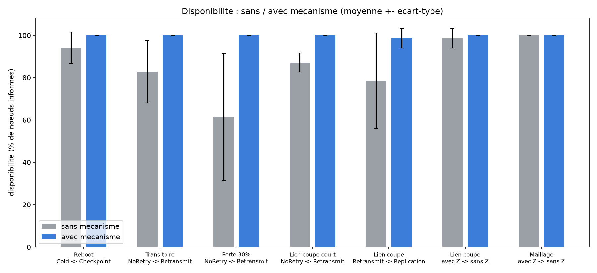
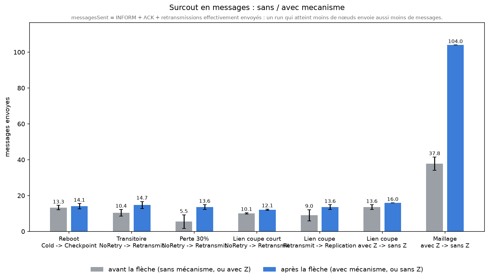
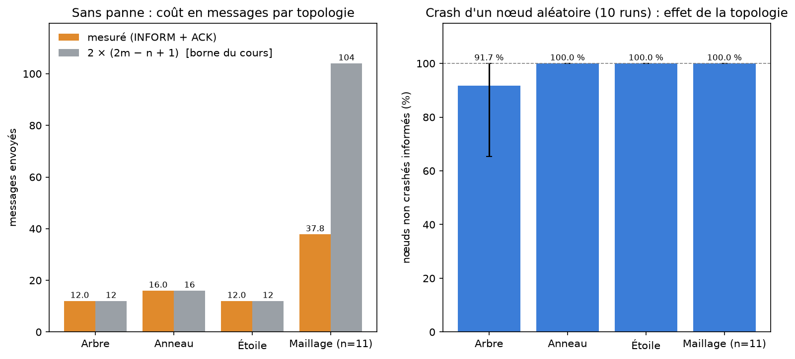
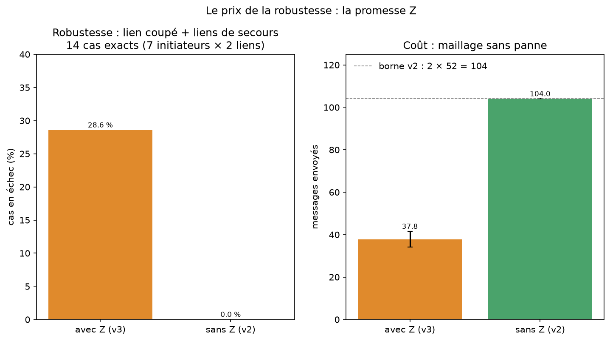
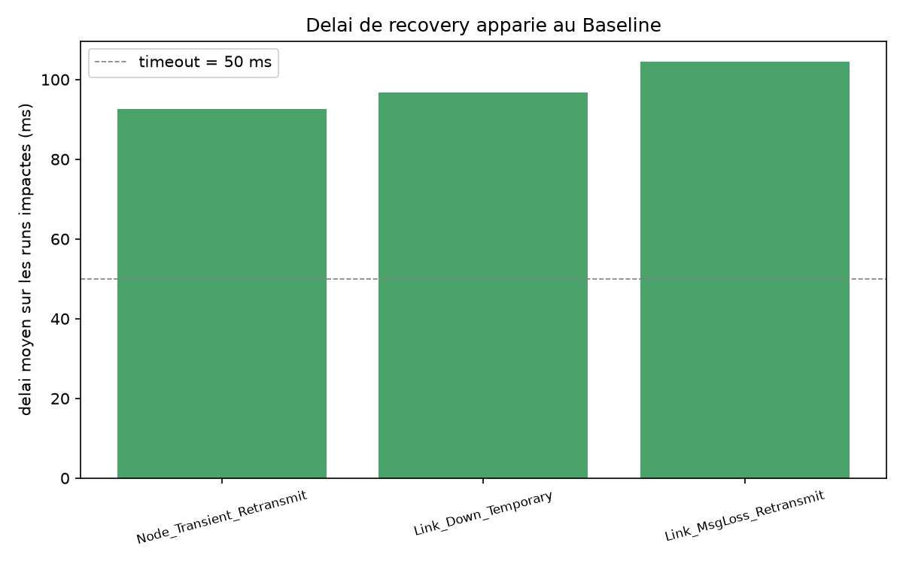
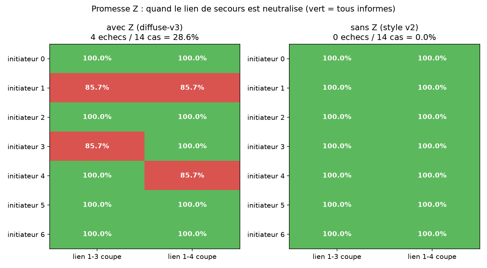

# Évaluation des performances

Cette section présente les mesures obtenues sur le simulateur (20 configurations × 10 runs, soit 200 exécutions OMNeT++). Tous les chiffres proviennent de `scripts/evaluate.py` et de `scripts/figure_z_table.py` ; les tableaux complets sont dans `report/evaluation_tables.md` et `results/eval_summary.csv`.

## Résumé des résultats

1. **Validation.** Sans panne, le simulateur retrouve exactement la borne du cours : 12, 16, 12 et 104 messages (arbre, anneau, étoile, maillage sans Z), soit 2 × (2m − n + 1).
2. **Détection.** Un crash est détecté en 200,0 ms, soit (maxRetries + 1) × timeout, dans les quatre topologies.
3. **Retransmission.** Elle ramène la disponibilité à 100 % pour la perte de messages (61,4 % → 100 %), la faute transitoire (82,9 % → 100 %) et la coupure courte (87,1 % → 100 %), pour 2 à 8 messages de plus. Sous 30 % de perte, elle produit 0,4 fausse suspicion par run.
4. **Checkpoint.** Le nœud rebooté est de nouveau informé dans 10 runs sur 10, contre 6 sur 10 en redémarrage à froid. Il rend le recovery possible, il ne le raccourcit pas.
5. **Promesse Z.** Avec Z, 4 cas sur 14 échouent (28,6 % = 2/7) lorsque le lien de secours est neutralisé ; sans Z, aucun. Le prix de la robustesse : 104 messages contre 37,8 sur le maillage, soit −64 % grâce à Z.
6. **Topologie.** Sous crash, l'arbre perd un sous-arbre (91,7 % des nœuds vivants informés) ; l'anneau, l'étoile et le maillage atteignent 100 %.

## 1. Protocole expérimental

Toutes les expériences portent sur diffuse-v3 simulé sous OMNeT++ 6.4.0, avec la couche de tolérance aux pannes décrite dans les sections précédentes : acquittements, timeout de 50 ms, 3 retransmissions au plus, checkpointing et liens de secours. Les topologies sont un arbre binaire de 7 nœuds (topologie principale), un anneau et une étoile de 7 nœuds, et un maillage de 11 nœuds (cas supplémentaire, hors de la fourchette 5 à 10 de la fiche). Chaque lien a un délai de 5 ms.

**Scénario aléatoire.** À chaque run, l'initiateur, la victime de la panne et le lien coupé sont tirés au hasard ; la victime n'est jamais l'initiateur. Chaque configuration est exécutée 10 fois (graines 0 à 9).

**Comparaisons appariées.** Le run k de deux configurations d'un même réseau a le même initiateur (vérifié par le script pour les 7 paires comparées). Chaque faute est donc comparée sans, puis avec son mécanisme, run par run. Nous donnons le delta moyen, son écart-type et un intervalle de confiance à 95 % (loi de Student, 9 degrés de liberté), ainsi que le nombre de runs où le mécanisme gagne, égalise ou perd.

| Métrique | Définition |
|---|---|
| Disponibilité | nœuds informés / nombre de nœuds (un nœud crashé informé avant sa panne compte comme informé) |
| Disponibilité sur nœuds vivants | même ratio, restreint aux nœuds non crashés en fin de run |
| Messages | `messagesSent` : INFORM + ACK + retransmissions effectivement envoyés (les messages bloqués ou détruits ne sont pas comptés) |
| Délai de recovery (retransmission) | fin de diffusion avec faute − fin de diffusion du Baseline, pour le même run |
| Recovery d'un nœud rebooté | du crash au moment où il est de nouveau informé : `max(recoveredAt, informedAt) − crashedAt` |
| Temps de détection | `unreachableAt − informedAt` |

## 2. Validation du simulateur

Avant de mesurer les pannes, nous vérifions que le simulateur reproduit les résultats du cours sur la diffusion sans faute. Chaque INFORM étant acquitté, `messagesSent` vaut 2 × le nombre d'INFORM, donc 2 × (2m − n + 1) pour diffuse-v2.

| Configuration sans panne | Messages mesurés (10 runs) | Borne 2 × (2m − n + 1) |
|---|---|---|
| Arbre (n = 7, m = 6) | 12, à chaque run | 12 |
| Étoile (n = 7, m = 6) | 12, à chaque run | 12 |
| Anneau (n = 7, m = 7) | 16, à chaque run | 16 |
| Maillage sans Z (n = 11, m = 31) | 104, à chaque run | 104 |
| Maillage avec Z (diffuse-v3) | 37,8 en moyenne (σ = 3,7) | 104 |

Les valeurs sont exactes (écart-type nul) et coïncident avec la borne du cours. Avec Z, le maillage passe nettement sous la borne, ce qui est l'intérêt de diffuse-v3. Dix-neuf vérifications automatiques, dont celles-ci, sont réussies (figure `eval_3`).

Le temps de détection d'un crash vaut **200,0 ms** dans les quatre topologies (minimum = maximum), soit (maxRetries + 1) × timeout = 4 × 50 ms.

## 3. Fautes de nœud

### 3.1 Crash permanent (détection seule)

Sur l'arbre, un crash aléatoire laisse 84,3 % des nœuds informés (σ = 25,6) et 91,7 % des nœuds non crashés. Le coût en messages est quasi nul (12,2 contre 12). Le mécanisme ne fait que **détecter** la panne, après 200 ms : il ne la répare pas. La forte variance s'explique par le tirage de la victime : un relais coupe son sous-arbre, une feuille ne coupe personne.

### 3.2 Crash puis reboot : Cold contre Checkpoint

| | Cold | Checkpoint |
|---|---|---|
| Disponibilité | 94,3 % (σ = 7,4) | 100 % |
| Delta apparié | | +5,71 points (σ = 7,38 ; IC95 ± 5,28) |
| Gains / égalités / pertes | | 4 / 6 / 0 |
| Messages | 13,3 | 14,1 (+0,8), soit 13 sauvegardes par run |
| Runs où le nœud rebooté est de nouveau informé | 6 sur 10 | 10 sur 10 |
| Recovery moyen (runs valides) | 116,6 ms | 104,4 ms (de 53,2 à 162,3 ms) |

Dans 4 runs sur 10, le nœud redémarré à froid reste non informé jusqu'à la fin. D'après le code, c'est le cas où il avait déjà été informé et acquitté avant de tomber : plus personne ne lui renvoie le message, et sa mémoire est vide. Ce sont exactement les 4 gains du checkpoint. Dans les 6 autres runs, une retransmission rattrape le nœud (le reboot, entre 60 et 150 ms, tombe dans la fenêtre de 200 ms de l'émetteur) et les deux mécanismes donnent le même résultat.

Le checkpoint ne **raccourcit** donc pas le recovery : il le rend **possible** dans 100 % des runs au lieu de 60 %. Les deux moyennes (116,6 ms et 104,4 ms) portent sur des ensembles de runs différents et ne se comparent pas directement. Le recovery du checkpoint est de plus dominé par le délai de reboot imposé par la configuration.

### 3.3 Faute transitoire

La disponibilité passe de 82,9 % (σ = 14,8) sans retransmission à 100 % avec, soit +17,14 points (IC95 ± 10,55 ; 8 gains, 2 égalités, 0 perte), pour +4,3 messages. Sans retransmission, l'émetteur abandonne après 50 ms, alors que le nœud sourd ne se réveille qu'entre 40 et 120 ms ; avec elle, un renvoi tombe après le réveil. Le délai de recovery apparié est de 92,5 ms en moyenne sur les 8 runs touchés.

## 4. Fautes de lien

| Paire (sans → avec) | Disponibilité | Delta apparié (points) | Gains / égalités / pertes | Messages (delta) |
|---|---|---|---|---|
| Perte 30 % : NoRetry → Retransmit | 61,4 % → 100 % | +38,57 ± 21,57 | 9 / 1 / 0 | +8,1 |
| Lien coupé court : NoRetry → Retransmit | 87,1 % → 100 % | +12,86 ± 3,23 | 9 / 1 / 0 | +2,0 (σ = 0) |
| Lien coupé permanent : Retransmit → Replication | 78,6 % → 98,6 % | +20,00 ± 12,93 | 10 / 0 / 0 | +4,6 |

**Perte de messages.** La retransmission fait passer la disponibilité de 61,4 % à 100 %, avec une variance très élevée sans elle (σ = 30,2). Elle a un défaut : 0,4 voisin par run est déclaré injoignable alors qu'aucun nœud n'a planté. C'est une **fausse suspicion**, qui apparaît quand les quatre échanges successifs perdent leur ACK. La théorie donne une probabilité de 0,51⁴ ≈ 6,8 % par lien, soit environ 0,41 sur les 6 liens de l'arbre, ce qui correspond à la mesure.

**Coupure courte.** Le delta de messages est exactement +2 à chaque run : ce n'est pas un surcoût de la retransmission, mais l'INFORM et l'ACK qui, bloqués pendant la coupure, sont enfin livrés.

**Délais de recovery.** Les délais observés (fin de diffusion moins celle du Baseline) valent 0, 50, 90, 100, 140 ou 150 ms (figure `eval_5`). Les 0 ms sont des runs non touchés par la faute. Les autres se regroupent près des multiples du timeout, car une retransmission arrive par pas de 50 ms, auxquels s'ajoutent quelques sauts de 5 ms. Le maximum, 150 ms, reste sous le délai d'abandon de 200 ms. Moyennes sur les runs touchés : 92,5 ms (transitoire, 8 runs sur 10), 96,7 ms (coupure courte, 9 sur 10), 104,4 ms (perte, 9 sur 10).

**Coupure permanente et liens de secours.** Les liens de secours améliorent la disponibilité dans les 10 runs (+20 points), mais elle reste inférieure à 100 % (98,6 %) : voir la section 5.

## 5. Le coût de la robustesse : la promesse Z

Dans diffuse-v3, Z est la liste des nœuds « déjà informés ou sur le point de l'être » : un nœud n'envoie jamais à un voisin de Z. C'est une **promesse**, valable sous la fiabilité totale supposée par le cours. Quand on la retire, un nœud qui ne peut pas tenir sa promesse la rompt sans que personne le sache, et les liens de secours sont neutralisés.

**Table de vérité exacte.** Sur l'arbre avec liens de secours 2-3 et 2-4 et le lien 1-3 ou 1-4 coupé en permanence, nous avons forcé les 14 combinaisons (7 initiateurs × 2 liens coupés) avec et sans Z (figure `eval_6`) :

| | Avec Z (v3) | Sans Z (v2) |
|---|---|---|
| Cas en échec | **4 sur 14 = 28,6 % (= 2/7)** | **0 sur 14** |
| Messages (10 runs tirés) | 13,6 | 16,0 |
| Voisins déclarés injoignables par run | 1,0 | 2,0 |
| Maillage sans panne : messages | 37,8 | 104 (**−64 %** avec Z) |

Avec Z, un échec survient si et seulement si l'initiateur est le nœud 1 (échec dans les 2 cas), ou la feuille (3 ou 4) dont le lien avec le nœud 1 est coupé. Dans ces cas, Z contient le nœud inaccessible : tous ses voisins le croient couvert et ne relaient jamais vers lui. Les autres initiateurs informent la feuille par le lien de secours.

**Pourquoi 10 runs ne suffisent pas.** Sur les 10 runs tirés de la campagne, un seul échec apparaît avec Z (+1,43 point de disponibilité, IC95 ± 3,23, non significatif). Sur 50 runs, nous observons 19 échecs sur 50 (38 %, disponibilité 94,6 %) avec Z et 0 sur 50 sans. L'écart avec les 28,6 % théoriques vient du tirage des initiateurs : l'initiateur 1, qui échoue toujours, est sorti 10 fois au lieu de 7 attendues ; les 19 échecs se répartissent en 10 (initiateur 1), 6 (initiateur 3) et 3 (initiateur 4), conformément à la table.

**Compromis.** Supprimer Z rend le protocole robuste sur ce scénario, au prix de plus de messages (104 contre 37,8 sur le maillage) et d'une double déclaration d'injoignabilité, chaque extrémité du lien coupé déclarant l'autre. Une piste intermédiaire, non implémentée, est une alerte de promesse rompue : un nœud qui déclare un voisin injoignable le signalerait pour que d'autres relaient.

## 6. Influence de la topologie sous crash

| Topologie | Disponibilité (tous nœuds) | Nœuds non crashés informés |
|---|---|---|
| Arbre | 84,3 % (σ = 25,6) | 91,7 % |
| Anneau | 95,7 % (σ = 6,9) | 100 % |
| Étoile | 92,9 % (σ = 7,5) | 100 % |
| Maillage | 96,4 % (σ = 4,7) | 100 % |

Dans l'arbre, un relais en panne coupe son sous-arbre. L'anneau et le maillage contournent la panne grâce à leurs chemins multiples. L'étoile obtient 100 % sur les nœuds vivants ; son point faible théorique est le centre, dont la panne isolerait toutes les feuilles. Sur ces 10 runs ce point faible ne s'est pas manifesté, et il n'a pas été testé de façon forcée : le résultat dépend de la victime tirée.

## 7. Synthèse

| Faute | Mécanisme | Gain mesuré | Coût | Limite |
|---|---|---|---|---|
| Perte de messages | Retransmission | +38,6 points | +8,1 messages | 0,4 fausse suspicion par run |
| Lien coupé court | Retransmission | +12,9 points | +2 messages (livraison) | |
| Faute transitoire | Retransmission | +17,1 points | +4,3 messages | |
| Crash puis reboot | Checkpoint | +5,7 points (récupération 10/10 contre 6/10) | 13 sauvegardes, +0,8 message | Recovery imposé par le délai de reboot |
| Lien coupé permanent | Liens de secours | +20 points | +4,6 messages | Neutralisés par Z dans 2/7 des cas |
| Promesse Z | Suppression de Z | 28,6 % → 0 % d'échec | 104 contre 37,8 messages (maillage) | Double déclaration d'injoignabilité |
| Crash permanent | Détection seule | détection en 200 ms | quasi nul | Pas de réparation |

## 8. Limites

- **10 runs par configuration** : des différences proches ne sont pas significatives, d'où les intervalles de confiance et l'appariement ; la table exacte de Z contourne ce problème.
- **Surcoût négatif.** Un surcoût de messages négatif (par exemple −54 % pour la perte sans retransmission) n'est pas une économie : moins de nœuds sont atteints, donc moins de messages partent. Il se lit toujours avec la disponibilité. De plus, `messagesSent` ne compte ni les messages bloqués ni les messages détruits, donc le surcoût de la retransmission est sous-estimé.
- **Recovery du reboot** dominé par le délai imposé dans la configuration ; le délai apparié n'est valable que pour les mécanismes à retransmission.
- **Détection à la demande** : pas de heartbeat, donc un nœud n'en suspecte que ceux auxquels il envoie ; pas de re-sondage après abandon.
- **Checkpoint en mémoire**, qui simule un stockage stable.
- **Réplication = redondance de chemins**, pas réplication d'état ; elle n'existe que sur l'arbre.
- Le maillage compte 11 nœuds, hors de la fourchette de la fiche.

## 9. Déclaration d'usage d'un LLM

Un assistant d'IA générative (Claude, Anthropic) a été utilisé pour la partie « évaluation » de ce projet. Il a servi à : expliquer les concepts du cours liés au sujet (modèles de fautes, semi-synchronie, diffuse-v3, checkpointing) ; aider à écrire les scripts d'analyse (`scripts/evaluate.py`, `scripts/figure_z_table.py`) et les correctifs de code associés (enregistrement des instants `crashedAt`, `recoveredAt` et `unreachableAt`, variante `useZ`, configurations de contrôle `NoRetry`) ; corriger les figures ; et proposer un brouillon de la présente section, relu par son auteur. Les simulations ont été lancées par l'équipe sur sa propre machine, et tous les chiffres de cette section proviennent des sorties réelles de ces simulations ; l'assistant n'a exécuté aucune simulation. L'usage d'un LLM dans les autres parties du projet est déclaré dans leurs sections respectives.

## Figures

